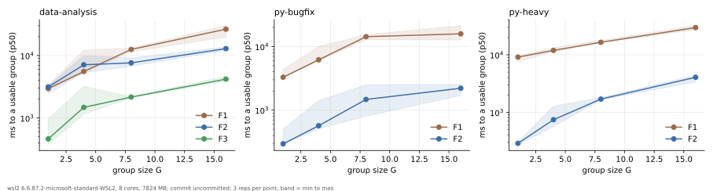
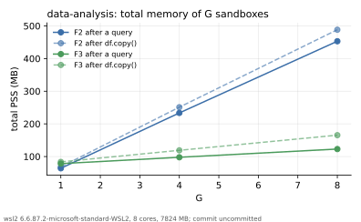
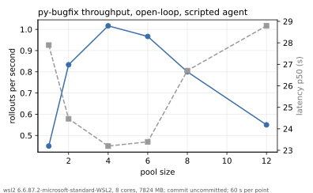
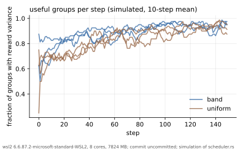
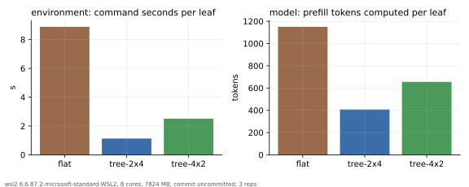

# Benchmarks

Raw data: `bench/results/*.json`, each with a machine fingerprint. Charts in
`docs/img/` and every table in `bench/results/tables.md` are generated by
`bench/charts.py` from those files only. Rerun everything with
`make bench-t3`.

**Machine:** the WSL2 laptop (kernel 6.6.87.2, 8 cores, 7.8 GB), release
build, L1 rootless, warm page cache. **It was not idle.** E1 started at a
load average of 27.7, with other test binaries using about 4 cores (recorded
in the result file). Treat the absolute numbers as an upper bound and the
ratios between modes as the result. Repetitions: 3 per point after one
discarded warm-up. These numbers should be repeated on an idle GitHub
Actions runner.

## E0: creation of one sandbox

207 L1 sandboxes, from the child's monotonic marks:

* The step medians sum to about 8 ms, but the median total is 19 ms and
  p99 is 199 ms.
* The tail is concentrated in `clone3`, `pivot_root` and the mounts.
* The hypothesis, not yet confirmed: the kernel is tearing down earlier
  sandboxes' mount namespaces in the background.

## E1: fork modes, latency to a usable group

Group of 8, p50:

| Family | F1 cold | F2 fs fork | F3 zygote |
|---|---|---|---|
| py-bugfix | 14.3 s | 1.5 s | n/a |
| py-heavy (13 MB SQLite built at preparation) | 16.5 s | 1.7 s | n/a |
| data-analysis (200k-row DataFrame in a kernel) | 12.5 s | 7.6 s | 2.2 s |

* F2 is about 10 times faster than F1 for both file-state families.
* For data-analysis F2 barely helps, because each sandbox still loads the
  kernel cold. F3 removes that.
* F2 is not flat in G on this machine: creating G sandboxes at once
  contends, and the machine was loaded.
* F4 is not implemented.

## E2: memory, data-analysis

Total PSS of G sandboxes (F3 includes the zygote once):

| G | F2 | F3 |
|---|---|---|
| 1 | 64 MB | 78 MB |
| 4 | 234 MB | 98 MB |
| 8 | 453 MB | 123 MB (165 MB after each sandbox copies the DataFrame) |

At G = 8, F3 uses 3.7 times less memory after a query. At G = 1 it costs
more, because the zygote's own process is counted.

## E3: throughput against pool size

py-bugfix, scripted 4-turn agent, open-loop at 4 offered rollouts/s, 60 s
per point:

| Pool | 1 | 2 | 4 | 6 | 8 | 12 |
|---|---|---|---|---|---|---|
| rollouts/s | 0.45 | 0.83 | **1.02** | 0.97 | 0.80 | 0.55 |

* The knee is at pool 4.
* Beyond it, throughput falls while per-rollout time rises from about 1.3 s
  to about 14 s.
* The likely cause is CPU: each rollout runs pytest three times plus a
  verification fork, on 8 shared cores.
* That is not confirmed with `perf`, and the load average at the start was
  18.

## E5: scheduling (simulation)

This is a simulation of `scheduler.rs` against known, skewed pass rates,
over 3 seeds:

* The difficulty band gives 0.89 useful groups against 0.84 for uniform
  sampling.
* That is about 6% fewer sandbox-seconds per useful group: a modest gain
  with this pass-rate mix.

A real-model E5 needs the GPU run.

## E6: branching, py-heavy, G = 8

| Shape | Command s per leaf | Prefill tokens per leaf | Prefix hit rate |
|---|---|---|---|
| flat | about 8.9 | 1150 | 0.80 |
| tree 2×4 | about 1.1 | 408 | 0.91 |
| tree 4×2 | about 2.5 | 655 | 0.87 |

The expensive first two turns are paid once per trunk on both sides. The
learning-side cost of correlated leaves is not measured (it needs a model).

## Not run

* E4 and the training run: no GPU.
* E7 (the kill-rate sweep and the 24-hour soak). Single kill-and-resume is
  tested in `tests/test_daemon.py`.
